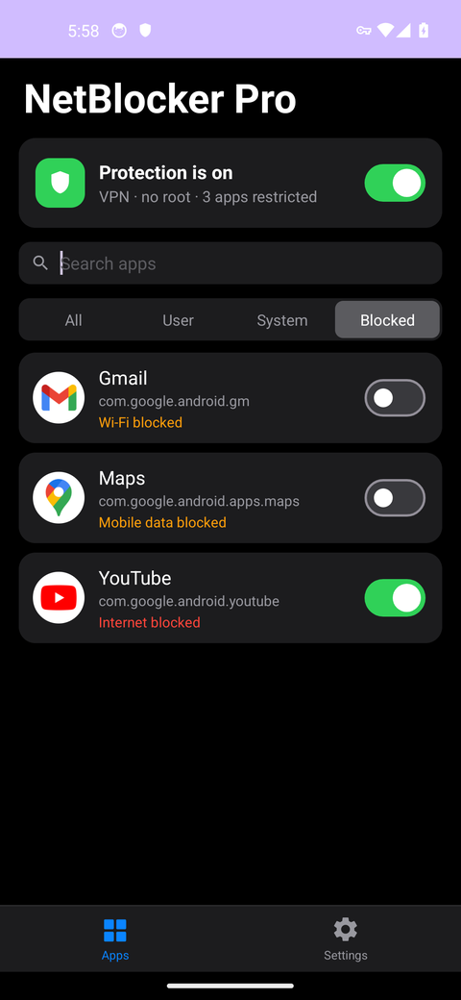
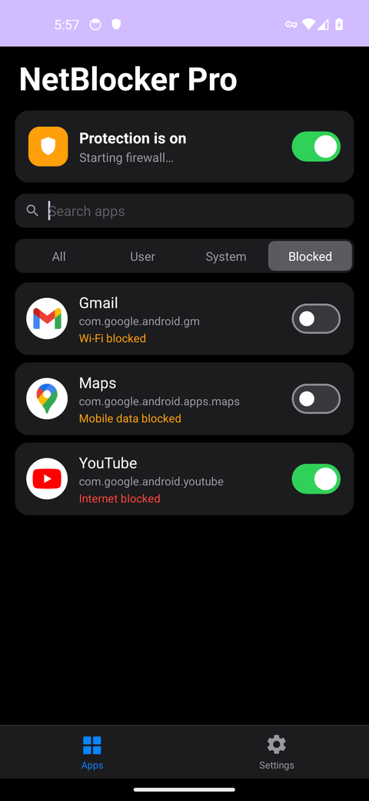
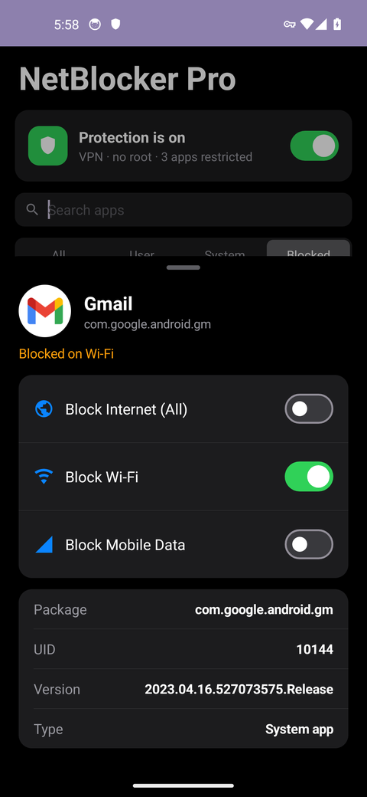
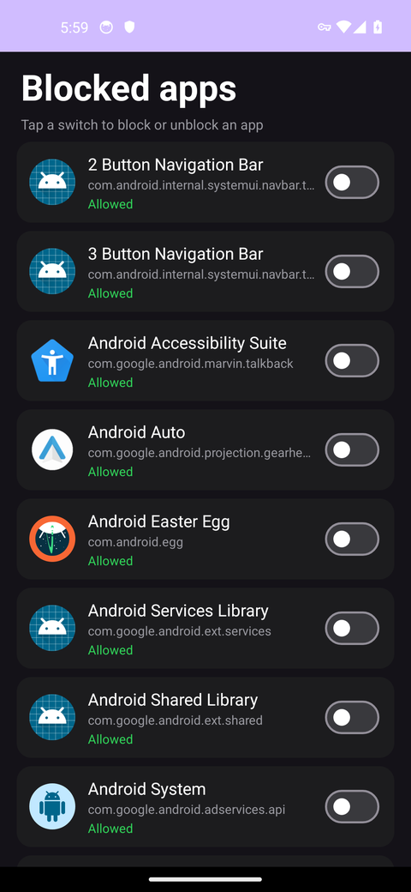
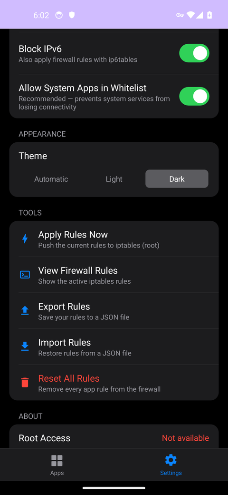

<div align="center">


# NetBlocker Pro

**Per-app network firewall for Android — block internet, Wi-Fi or mobile data for any app.**

Works with **or without root** · No tracking · No ads · iOS-style UI

[](#)
[](#)
[](../../releases/latest)
[](LICENSE)

[Download the latest APK](../../releases/latest) · [Report an issue](../../issues)

</div>

---

## What is it?

NetBlocker Pro cuts network access for any app on your device — completely, or only over
**Wi-Fi**, or only over **mobile data**. It ships with two blocking engines and picks the best
one automatically:

| Engine | Root needed | Technique |
|---|---|---|
| 🔩 **iptables** | ✅ yes | Per-UID kernel firewall rules pushed through `su` (the AFWall+ technique) |
| 📡 **Local VPN** | ❌ no | Allowed apps **bypass the tunnel entirely**; blocked apps' packets enter it and are discarded |

With **Automatic** mode, rooted phones get kernel-level blocking and everyone else gets the
VPN engine — so the app works on any device. You can force either engine in Settings.

## Screenshots

| Apps | Blocked filter | App options |
|---|---|---|
|  |  |  |

| Picker | Settings | Widgets |
|---|---|---|
|  |  |  |

## Features

- 🔌 **Block internet entirely** for any app with one tap
- 📶 **Block Wi-Fi only** or **📱 block mobile data only** (long-press an app)
- 🔄 **Blacklist mode** (block selected apps) and **Whitelist mode** (allow only selected apps)
- 🧠 **Dual engines with automatic selection** — root (iptables) or VPN (no root)
- 🪟 **Home screen widgets** — a 1×1 protection toggle and a resizable blocked-apps list
  with an add/remove picker; the bigger the widget, the more apps it shows
- ⚡ **Quick Settings tile** — toggle protection from the notification shade
- 🔍 Instant search + filters for **All / User / System / Blocked** apps
- ♻️ Rules re-applied automatically on **boot**
- 💾 **Export / import rules** as JSON · live iptables rule viewer
- 🌗 **Automatic / Light / Dark** theme (true iOS dark palette)

## Installation

1. Grab the APK from [Releases](../../releases/latest).
2. Install it (Android 8.0+).
3. Flip **Protection** on:
   - **Rooted phone** → grant superuser → kernel firewall.
   - **Normal phone** → accept the one-time **VPN connection request** → VPN firewall.
4. Tap any app's switch to cut its internet. Done ✅

## How the VPN engine blocks without a VPN server

The tunnel is used only as a filter — nothing is ever forwarded or proxied:

- **Allowed apps** are excluded from the tunnel with `addDisallowedApplication()`, so their
  traffic flows over the normal network untouched.
- **Blocked apps** are not excluded — their packets enter the tunnel and are discarded there.
- Wi-Fi vs mobile-data rules are applied by re-establishing the tunnel with a different
  exclusion list when the network type changes.

Battery cost is negligible, and no traffic ever leaves the device.

## Build from source

```bash
git clone https://github.com/Shishir-ip/NetBlocker-Pro.git
cd NetBlocker-Pro
./gradlew assembleRelease
```

Gradle wrapper 8.12, Android Gradle Plugin 8.7.3, JDK 17+.

### Signing

Signing credentials are **not** stored in this repository. Generate a keystore outside the
project, copy `signing.properties.example` to `signing.properties` and fill in your values.
Without it, release builds fall back to the debug keystore. APKs are published as release
assets only — never committed.

## FAQ

**Does it need root?**
No — without root the local-VPN engine is used (one-time consent dialog). With root you get
kernel-level iptables blocking instead.

**Does it drain the battery?**
The root engine is pure kernel rules (no cost). The VPN engine adds a small overhead, like any
VPN-based firewall.

**An app still connects after being blocked?**
Check that the status card shows *Firewall active*, then use **Settings → Apply Rules Now**.
For the root engine, also enable **Block IPv6** if the network uses IPv6.

## Disclaimer

NetBlocker Pro is provided as-is, for educational and personal use. Blocking system components
from the network can cause unexpected behavior — use common sense. The developer is not
responsible for lost connectivity, broken apps, or any other damage.

## License

Released under the [MIT License](LICENSE).
